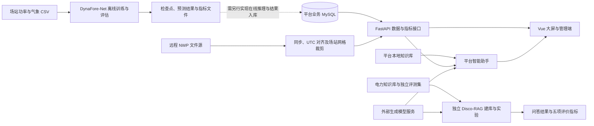

# 气象赋能能源项目代码总览

本目录汇总新能源功率预测、电力知识问答和运行监测平台三部分代码，用于理解方案结构、开展研究实验及配置应用演示。

**代码组成：DynaFore-Net 负责分场站超短期功率预测，Disco-RAG 负责电力知识问答与消融评测，新能源消纳与并网智能调控平台负责数据接入、可视化和辅助决策。** 三个子目录有各自的依赖、配置和运行入口，应分别安装与启动。

本文依据当前目录的 README、依赖文件、命令行入口及平台接口源码整理。整理日期：2026-10-14。本次仅核对源码和文档，未启动真实场站训练、在线模型调用或生产服务。

## 1. 项目导航

| 子项目 | 主要作用 | 主要技术 | 首先阅读 |
| --- | --- | --- | --- |
| `DynaFore-Net/` | 风电、光伏分场站预测；训练、消融、评估和结果汇总 | Python、PyTorch、NumPy、Pandas | [模型说明](DynaFore-Net/README.md) |
| `Disco-RAG-OpenSource/` | 电力知识检索、结构化推理、问答生成及五组方法评测 | Python、Transformers、FAISS、OpenAI 兼容生成接口 | [问答与评测说明](Disco-RAG-OpenSource/README.md) |
| `新能源消纳与并网智能调控平台-open-source/` | 功率与气象监测、预测展示、消纳分析、智能调控助手和管理端 | Vue 3、TypeScript、FastAPI、MySQL、ECharts | [平台说明](新能源消纳与并网智能调控平台-open-source/README.md) |

按使用目的选择入口：

- **看平台功能或准备演示**：先读平台 README，再配置数据库、NWP 和模型接口。
- **训练功率预测模型**：先读 DynaFore-Net README 与数据格式说明。
- **复现电力问答实验**：先读 Disco-RAG README，再准备知识库、评测集、嵌入模型和生成服务。
- **了解整套方案**：先读本文，再按下方目录导航进入具体实现。

## 2. 总体结构与接入关系

```text
所有代码/
├─ README.md                             本总览
├─ DynaFore-Net/
│  ├─ src/dynafore_net/                   模型、增强、数据、训练、评估及 CLI
│  ├─ configs/                           默认训练参数
│  ├─ tests/                             模型行为与流程测试
│  ├─ scripts/                           发布检查和打包
│  └─ docs/                              实现及已有验证记录
├─ Disco-RAG-OpenSource/
│  ├─ src/                               RST、修辞图、规划与生成等结构模块
│  ├─ power_eval/                        电力领域适配、检索和评测管线
│  ├─ scripts/                           建库、运行问答、计算指标
│  ├─ tests/                             使用合成文本和 mock 客户端的测试
│  ├─ data/                              数据格式说明
│  └─ docs/                              发布检查说明
└─ 新能源消纳与并网智能调控平台-open-source/
   ├─ backend/app/                       FastAPI 接口、业务适配与智能助手
   ├─ backend/rag_core/                  平台附带的 RAG 核心
   ├─ backend/tests/                     后端测试
   ├─ frontend/                          Vue 大屏及管理页面
   ├─ scripts/                           NWP 检查和提取工具
   ├─ data/weather/                      NWP 运行数据目录占位
   └─ docs/                              系统架构和数据接入说明
```



**当前接入边界：**

- 平台通过数据库适配器读取功率与预测记录，当前接口源码未直接导入 `DynaFore-Net` 的训练包。将研究模型用于线上预测，需要补充特征构造、检查点加载、推理调度和结果入库。
- 平台包含自己的 `backend/rag_core/`，并由 `app/assistant/service.py` 使用其中的知识加载、检索和模型客户端。它不是自动调用旁边的整个 Disco-RAG 实验目录。
- 当前平台助手使用本地 TF-IDF 检索、实时业务上下文、规则策略与模型生成；独立 Disco-RAG 实验支持 Qwen3-Embedding-8B / FAISS 以及 RST、修辞图和规划消融。两者的检索与推理路径应分别说明。
- 平台存在未配置模型密钥或模型调用失败时的规则兜底。能返回建议，不等于完整模型推理链路已正常运行。

## 3. DynaFore-Net：超短期功率预测

### 3.1 功能与实现位置

模型面向风电、光伏场站独立训练，默认输入过去 **288 个 15 分钟点，即 72 小时**，预测未来 **16 个点，即 4 小时**。

| 文件 | 作用 |
| --- | --- |
| `src/dynafore_net/model.py` | 主模型、未来气象交叉注意力、风光机理修正与输出边界 |
| `src/dynafore_net/attention.py` | PVA / TRA 等注意力组件 |
| `src/dynafore_net/augmentation.py` | AutoDA 任务适配和细粒度虚拟相位重构 |
| `src/dynafore_net/data.py` | CSV 发现、时间对齐、容量读取、窗口构造与数据划分 |
| `src/dynafore_net/training.py` | 分场站训练、最佳检查点选择及消融配置 |
| `src/dynafore_net/evaluation.py` | 检查点加载与测试评估 |
| `src/dynafore_net/metrics.py` | 预测误差和辅助指标 |
| `src/dynafore_net/cli.py` | `prepare`、`train`、`run`、`evaluate`、`summarize` 入口 |

保留的模型组件包括 PMD-PVA-TRA、NSAN、频谱门控、多尺度融合、未来条件交叉注意力和机理引导修正。AutoDA 与预测器联合优化，验证和测试阶段不使用训练增强。

### 3.2 输入数据

原始 CSV 放在用户指定的数据目录，通过 `--raw-dir` 接入。主要命名模式：

```text
zdata_<station>_wind_power_real_15min.csv
zdata_<station>_wind_tower_15min.csv
zdata_<station>_pv_power_real_15min.csv
zdata_<station>_qxz_15min.csv
```

功率文件使用 `DATE_TIME`、`ACTIVE_POWER`；气象字段按风电或光伏类型组织。容量须由场站元数据或 `--capacity-json` 提供，不从测试集功率反推。详细字段、单位和缺失值规则见 [数据格式说明](DynaFore-Net/DATA_AVAILABILITY.md)。

当前整理版的未来气象输入是预测区间对应的**实测气象序列**，不能将该实验条件下的精度直接视作在线 NWP 预报条件下的精度。部分继承通道名称带有 `nwp`，不代表当前数据管线实际读取 NWP。

### 3.3 安装与运行

以下 PowerShell 命令从“所有代码”目录开始执行；数据路径需替换为实际位置。

```powershell
Set-Location .\DynaFore-Net
python -m venv .venv
.\.venv\Scripts\Activate.ps1
python -m pip install -e .
python -m dynafore_net --help

# 准备数据
dynafore prepare --raw-dir "D:\private_power_csvs" --output outputs

# 分场站训练；GPU 须显式指定，如 cuda:0
dynafore train --output outputs --config configs/default.json --device cpu

# 从最佳检查点重新评估并汇总
dynafore evaluate --output outputs --device cpu
dynafore summarize --output outputs
```

Python 要求 3.10+。依赖包括 NumPy、Pandas 和 PyTorch；使用 GPU 时安装与运行设备匹配的 PyTorch。

完整模型和四组消融：

```powershell
dynafore run --raw-dir "D:\private_power_csvs" --output outputs_ablations --variants full noPMD-PVA-TRA noNSAN noAutoDA "noguided correction" --device cuda:0
```

默认最大 20 epoch，验证 ACC@16 决定最佳检查点和早停；有效起点按时间顺序划分为 70% / 15% / 15%，并清除目标区间跨集合边界的窗口。标准化统计量仅由训练窗口拟合。已有缓存或模型默认不覆盖，重跑建议使用新的输出目录。

### 3.4 输出与指标

- `runs/<station>/<variant>/checkpoint.pt`：最佳模型及关联配置、统计量等。
- `training_log.csv`、`metrics_val.json`、`metrics_test.json`：训练与评估记录。
- `results_by_station.csv`：分场站结果。
- `results_variant_mean.csv`、`results_kind_variant_mean.csv`：变体和类型的非加权场站均值。
- `1st_count.csv`：已有结果中逐场站最优指标计数，并列最优各计一次。

主指标为 MSE@16、MAE@16、nMAE@16、nRMSE@16、ACC@16。误差指标越低越好，ACC 越高越好。MSE 单位为 MW²，MAE / RMSE 单位为 MW；nMAE / nRMSE 输出比值，ACC 输出百分数。

ACC 按每个预测起点的误差计算后求均值，**不是 `100 × (1 - nRMSE)`**。具体公式和消融关闭范围见 [实现与复现说明](DynaFore-Net/docs/IMPLEMENTATION.md)。本包未包含 XGBoost、PatchTST、iTransformer、Informer、TimeMixer 或 SimDiff 基线实现。

## 4. Disco-RAG：电力知识问答与评测

### 4.1 方法组成

本目录是基于上游 Disco-RAG 结构模块的电力领域适配，包含独立生成服务接入、知识库索引和五种方法的评测入口。

| 方法 ID | 内容 |
| --- | --- |
| `disco_full` | RST 树、修辞图和规划均启用 |
| `without_rst` | 关闭 RST 树 |
| `without_graph` | 关闭修辞图 |
| `without_planning` | 关闭规划 |
| `standard_rag` | 标准 RAG 对照 |

| 目录或文件 | 作用 |
| --- | --- |
| `src/` | RST、修辞图、规划、生成和检索结构模块 |
| `power_eval/config.py` | 从环境变量读取模型服务和数据配置 |
| `power_eval/index.py` | TF-IDF 检索与 FAISS 嵌入索引适配 |
| `power_eval/ablation.py` | 五组实验配置与回答器 |
| `power_eval/elecbench.py` | 评测问题读取和断点续跑 |
| `scripts/build_power_faiss.py` | 构建知识库 FAISS 索引 |
| `scripts/run_power_eval.py` | 生成各方法答案 |
| `scripts/evaluate_saved_answers.py` | 对已有答案计算指标与汇总 |

### 4.2 数据和模型准备

- 知识库：有使用权的 UTF-8 TXT，可放置于 `data/corpus/` 下并包含子目录。
- 评测集：JSONL，支持 `question` / `answer` 或 `input` / `output` 字段；可选 `index_class`。
- 嵌入模型：本地准备 Qwen3-Embedding-8B，模型路径通过环境变量设置。
- 生成模型：使用外部 OpenAI 兼容接口；此目录不负责启动模型服务。

知识库和测试参考答案分开存放。题目文件名与行号参与构造样本 ID，续跑期间不要重排评测文件。详见 [数据说明](Disco-RAG-OpenSource/data/README.md)。

### 4.3 安装与运行

在新的 PowerShell 终端从“所有代码”目录开始，使用单独的虚拟环境：

```powershell
Set-Location .\Disco-RAG-OpenSource
python -m venv .venv
.\.venv\Scripts\Activate.ps1
python -m pip install -r requirements.txt
python -m pip install -r requirements-metrics.txt
python -m pip install -r requirements-dev.txt

# 将以下占位值替换为自己的配置；密钥不要写入源码
$env:POWER_LLM_API_KEY = "REPLACE_WITH_YOUR_KEY"
$env:POWER_LLM_BASE_URL = "http://127.0.0.1:8000/v1"
$env:POWER_LLM_MODEL = "实际生成服务返回的模型ID"
$env:POWER_CORPUS_ROOT = "data/corpus"
$env:ELECBENCH_ROOT = "data/benchmark"
$env:POWER_EMBEDDING_MODEL = "models/Qwen3-Embedding-8B"
$env:POWER_FAISS_INDEX = "indexes/power_public_qwen3e8b_faiss"
$env:POWER_RAG_TOP_K = "10"
$env:POWER_LLM_TEMPERATURE = "0"
$env:POWER_LLM_MAX_TOKENS = "1024"
$env:POWER_LLM_TIMEOUT = "300"
$env:POWER_EMBEDDING_BATCH_SIZE = "2"

# 构建索引
python scripts/build_power_faiss.py --corpus "$env:POWER_CORPUS_ROOT" --model "$env:POWER_EMBEDDING_MODEL" --output "$env:POWER_FAISS_INDEX" --chunk-size 256 --batch-size 2

# 先核对数据与路径，再运行全量问答
python scripts/run_power_eval.py --dry-run
python scripts/run_power_eval.py --methods disco_full without_rst without_graph without_planning standard_rag --start-index 0 --max-items 0 --output-dir results/full_en
```

`8000` 是上面示例为外部模型服务选择的端口，须换成实际地址；代码配置的默认地址是 `8001/v1`。平台后端也使用 `8001`，因此同机运行时必须区分两种服务。平台的 FastAPI 业务接口不能直接当作生成模型的 `/v1` 接口。

本项目通过进程环境变量读取配置，PowerShell 中仅复制 `.env.example` 为 `.env` 不会自动加载变量。Linux 的 `.env` 加载方式见子项目 README。示例中的 `Qwen3.8-27B` 是部署名称，实际请求 ID 以所连接服务为准。

### 4.4 评分与结果

```powershell
python scripts/evaluate_saved_answers.py --stage basic --input-dir results/full_en --output-dir results/full_metrics
python scripts/evaluate_saved_answers.py --stage bert --input-dir results/full_en --output-dir results/full_metrics --device cuda:0
python scripts/evaluate_saved_answers.py --stage summac --summac-mode entailment --input-dir results/full_en --output-dir results/full_metrics --device cuda:0
```

五项指标为 **Token F1、ROUGE-L F1、BERTScore-F1、SummaCZS、ART**。答案按方法写入 JSONL，指标汇总写入 `summary.csv` / `summary.json`；语义指标模型需另外准备。

正式默认参数为 top-k=10、temperature=0、最终生成预算 1024 token、英文输出，结构阶段单次预算 256 token。嵌入采用 last-token pooling 与归一化向量，256 token 分块、不重叠。

`--max-items 0` 表示全量。已有成功且非空答案可跳过，失败或空答案重试；修改模型、知识库或参数时更换输出目录。ART 包含在线检索、结构解析、规划和生成，指标计算不计入 ART。SummaC 的 `entailment` 与 `signed` 是不同口径，应显式指定并记录。

## 5. 新能源消纳与并网智能调控平台

### 5.1 页面与能力

| 页面路由 | 用途 |
| --- | --- |
| `/dashboard` | 场站地图、实时状态、功率趋势及预测展示 |
| `/weather` | 历史气象观测与趋势 |
| `/weather/nwp` | 最新 NWP 起报与场站预报 |
| `/stations/:id` | 单场站详情 |
| `/analysis` | 消纳、弃电和预测误差分析 |
| `/assistant` | 业务数据结合知识检索的问答与辅助调控建议 |
| `/admin/login`、`/admin` | 管理端登录、配置展示、场站开关和审计记录 |

平台当前管理状态和部分连接状态标记包含内存或静态实现，不能仅根据界面显示的 `connected` / `configured` 认定外部服务已经通过真实连通性检查。

### 5.2 核心实现位置

| 文件或目录 | 作用 |
| --- | --- |
| `backend/app/main.py` | FastAPI 入口与 NWP 后台刷新任务 |
| `backend/app/config.py` | 业务配置，读取 `backend/.env` |
| `backend/app/adapters/stations.py` | MySQL 场站、功率、气象和预测记录适配 |
| `backend/app/api/routes.py` | 场站、概览、预测、气象与实时流接口 |
| `backend/app/api/assistant_routes.py` | 助手状态、问答及附件解析接口 |
| `backend/app/assistant/service.py` | 意图判断、实时上下文、知识检索、策略与报告生成 |
| `backend/app/nwp/` | NWP 文件选择与定时刷新 |
| `backend/app/services/` | 时间对齐、NWP 处理和业务指标 |
| `backend/rag_core/` | 平台使用的知识库与模型客户端核心 |
| `frontend/src/router/index.ts` | 前端页面路由 |
| `frontend/src/api/` | API 请求与数据类型 |
| `frontend/src/views/` | 大屏、分析、助手和管理页面 |
| `frontend/src/components/dashboard/` | 地图、趋势图和大屏组件 |

### 5.3 配置与启动

环境要求按平台 README：Python 3.11+、Node.js 20+；真实业务数据使用 MySQL 8.0+。NWP 远程接入使用 OpenSSH，GRIB 解析还需要 ecCodes。

终端一：从“所有代码”目录启动后端。

```powershell
Set-Location .\新能源消纳与并网智能调控平台-open-source\backend
python -m venv .venv
.\.venv\Scripts\Activate.ps1
python -m pip install -e ".[dev,nwp]"
Copy-Item .env.example .env
# 编辑 .env，填写实际配置后再启动
python -m uvicorn app.main:app --host 127.0.0.1 --port 8001
```

已有 `.env` 时保留原配置，不重复覆盖。

终端二：从“所有代码”目录启动前端。

```powershell
Set-Location .\新能源消纳与并网智能调控平台-open-source\frontend
npm ci
npm run dev
```

开发访问地址为 `http://127.0.0.1:5173`，前端 `/api` 请求代理至 `http://127.0.0.1:8001`。后端接口文档为 `http://127.0.0.1:8001/docs`，健康接口为 `/api/health`。

重点配置分组：

| 分组 | 配置项 |
| --- | --- |
| MySQL | `MYSQL_HOST`、`MYSQL_PORT`、`MYSQL_USER`、`MYSQL_PASSWORD`、`MYSQL_DATABASE` |
| 预测数据表 | `FORECAST_TABLE_PREFIX` |
| NWP | `NWP_SSH_HOST`、`NWP_SSH_PORT`、`NWP_SSH_USER`、`NWP_REMOTE_DIR`、`NWP_REFRESH_HOURS` |
| 运行参数 | `TIMEZONE_NAME`、`REALTIME_INTERVAL_SECONDS` |
| 生成模型 | `POWER_LLM_API_KEY`、`POWER_LLM_BASE_URL`、`POWER_LLM_MODEL`；另保留兼容的 DeepSeek 变量 |
| 管理账号 | `ADMIN_USERNAME`、`ADMIN_PASSWORD` |

NWP 默认刷新时刻来自源码配置 `2,4,9,14,16,21`，时区为 `Asia/Shanghai`。实测气象按 UTC+8 使用，NWP 原始 UTC 转换后对齐，保留起报和有效时间。

从平台项目根目录手动提取最新 NWP：

```powershell
python scripts/extract_latest_nwp.py --remote nwp-host --remote-dir /path/to/nwp/48h
```

`nwp-host` 和远程目录是占位值，需配置自己的 SSH 别名和实际路径。接入字段、时间规则和数据范围见 [平台数据接入说明](新能源消纳与并网智能调控平台-open-source/docs/DATA_ACCESS.md)。

### 5.4 常用接口

| 接口 | 用途 |
| --- | --- |
| `GET /api/stations` | 场站列表 |
| `GET /api/stations/{station_id}/snapshot` | 单站实时快照 |
| `GET /api/stations/{station_id}/power-series` | 历史功率 |
| `GET /api/stations/{station_id}/forecast-window` | 预测窗口 |
| `GET /api/stations/{station_id}/forecast-metrics` | 预测误差指标 |
| `GET /api/overview/realtime` | 全局实时概览 |
| `GET /api/overview/consumption` | 消纳概览 |
| `GET /api/overview/weather-observation` | 气象概览 |
| `GET /api/overview/nwp-latest` | 最新 NWP |
| `GET /api/stream/realtime` | 实时事件流 |
| `GET /api/assistant/status` | 助手状态 |
| `POST /api/assistant/chat` | 助手问答 |

完整接口、参数和返回结构以运行服务的 `/docs` 为准。平台输出属于辅助分析和建议，源码中这些接口不等于已接入实际调度控制执行。

## 6. 建议运行顺序

1. **分别创建环境**：三个后端/算法项目独立安装依赖，平台前端单独安装 Node 依赖。
2. **先准备数据**：确认功率 CSV、容量、业务数据库、NWP、知识库和评测集均已具备。
3. **先验证小范围运行**：使用子项目提供的合成测试、路径检查或单站调试入口确认流程。
4. **完成独立实验**：按需要运行 DynaFore-Net 训练、预测评估和 Disco-RAG 全量问答评测。
5. **配置平台接入**：根据实际数据表、SSH 和模型服务启动平台，核对时间、单位与缺失状态。
6. **集成研究模型**：如需展示自己的 DynaFore-Net 输出，实现线上推理与数据库写入；如需平台采用完整 Disco-RAG，替换助手推理入口并统一知识库及参数。

训练和正式评测可放在具备所需资源的 GPU 服务器；前端与业务后端不要求与训练进程部署在同一机器。实际内存、磁盘和 GPU 需求取决于场站数据规模与所选模型，不在本文给出未经测量的资源保证。

## 7. 测试与构建命令

以下命令在对应子项目目录运行：

| 子项目 | 命令 | 验证范围 |
| --- | --- | --- |
| DynaFore-Net | `python -m unittest discover -s tests -v` | 合成数据、模型行为和训练/评估流程 |
| DynaFore-Net | `python scripts/check_release.py` | 源码发布内容检查 |
| Disco-RAG | `python -m pytest tests -q` | 合成文本、mock 客户端和评测逻辑 |
| 平台后端 | `python -m pytest tests -q` | 配置、数据适配、接口、时间与指标等 |
| 平台前端 | `npm run build` | TypeScript 检查和 Vite 构建 |

DynaFore-Net 已有 [整理包验证记录](DynaFore-Net/docs/VERIFICATION.md)，其中列出了原整理过程的检查和环境。本总览没有重新执行这些测试，不把已有记录写成此次运行结果。合成测试通过也不代表已经复现真实数据的全部实验精度。

## 8. 数据、许可与文档索引

三个项目的说明均表明：数据集、生产业务数据、模型权重、向量索引、原始知识库和真实实验输出不随源码分发。数据访问或合作联系：**ts26170007a31@cumt.edu.cn**。访问条件以数据提供方的授权为准。

本目录不采用统一许可证，分别遵循子项目现有说明：

| 子项目 | 当前文档记录的许可状态 |
| --- | --- |
| DynaFore-Net | 保留研究使用条款，具体范围见 [LICENSE](DynaFore-Net/LICENSE) |
| Disco-RAG | 上游许可证文本待核实，当前为发布准备稿，见 [NOTICE](Disco-RAG-OpenSource/NOTICE.md) |
| 新能源平台 | 源码使用 [MIT License](新能源消纳与并网智能调控平台-open-source/LICENSE)，第三方数据与模型单独遵循各自条款 |

进一步阅读：

- [DynaFore-Net 中文说明](DynaFore-Net/README.md) / [英文说明](DynaFore-Net/README_EN.md)
- [DynaFore-Net 数据格式](DynaFore-Net/DATA_AVAILABILITY.md)
- [DynaFore-Net 实现与复现说明](DynaFore-Net/docs/IMPLEMENTATION.md)
- [DynaFore-Net 第三方来源说明](DynaFore-Net/THIRD_PARTY_NOTICES.md)
- [Disco-RAG 运行与评测说明](Disco-RAG-OpenSource/README.md)
- [Disco-RAG 数据格式](Disco-RAG-OpenSource/data/README.md)
- [Disco-RAG 发布检查说明](Disco-RAG-OpenSource/docs/RELEASE_CHECKLIST.md)
- [平台总体说明](新能源消纳与并网智能调控平台-open-source/README.md)
- [平台系统架构](新能源消纳与并网智能调控平台-open-source/docs/ARCHITECTURE.md)
- [平台数据接入](新能源消纳与并网智能调控平台-open-source/docs/DATA_ACCESS.md)
- [平台 RAG 核心说明](新能源消纳与并网智能调控平台-open-source/backend/rag_core/README.md)
