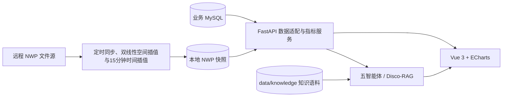

# 系统架构

平台采用前后端分离和数据适配层设计。Vue 前端通过 REST 与流式接口访问 FastAPI；后端将 MySQL 功率数据、气象观测、预测结果和本地 NWP 快照转换为统一场站领域模型；智能调控服务在此上下文上执行意图识别、知识检索、策略评估与回答生成。

消纳指标只使用实际功率与可利用功率：`弃电 = max(0, 可利用 - 实际)`，`消纳率 = 实际 / 可利用`。`data/powergridqa/` 是评测集，不进入知识检索。

生产环境需要在平台之外补充反向代理、TLS、正式身份认证、权限控制、集中日志和密钥管理。智能体输出仅用于辅助决策，不能绕过调度授权与安全校核。
